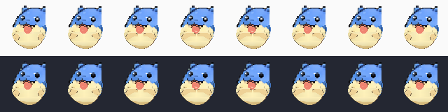

# Spheal Patch 22 → Patch 23 visual comparison

**How to read**: the left is the preserved Patch 22 commit; the right is Patch 23. These linked image pairs display the same original PNG frame (no resizing algorithm or overlay). The attached contact sheets show all edited poses with the light background above and the dark background below.

## Clap peak (frame 04)

| Patch 22: long warm crease | Patch 23: two short diagonal side creases |
|---|---|
|  |  |

The broad Patch 22 shading is removed in all eight frames. Only 03–06 receive small new fold pixels. Frame 04 and 05 are identical in each version to hold the clap pose.

## Water Gun maximum extension (frame 06)

| Patch 22: flat/cropped tip | Patch 23: staggered/tapered tip |
|---|---|
|  |  |

The open mouth and head pixels are identical. Water from 04–08 remains a single thick connected column. The x=0 truncated cut of 06 is removed.

## Frame sheets

Clap columns: 01, 02, 03, 04, 05, 06, 07, 08. Upper row: light; lower row: dark.

Water Gun columns: 04, 05, 06, 07, 08. Upper row: light; lower row: dark.

**Scope**: source PNGs are pixel-level full-body frames. Screenshots/sheets do not establish Windows Electron animation quality. Actual Electron manual verification is still required.
